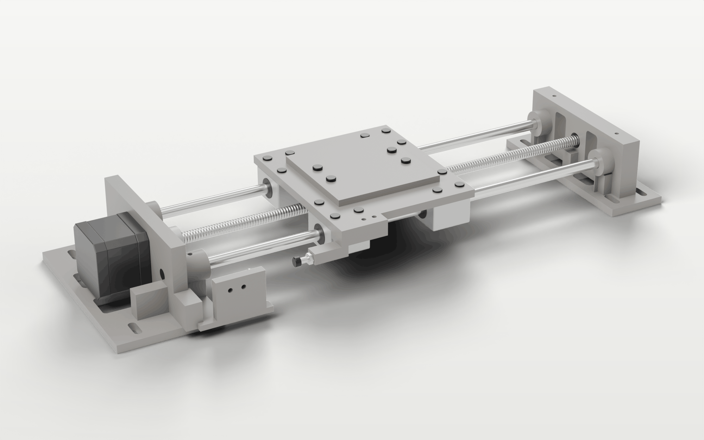
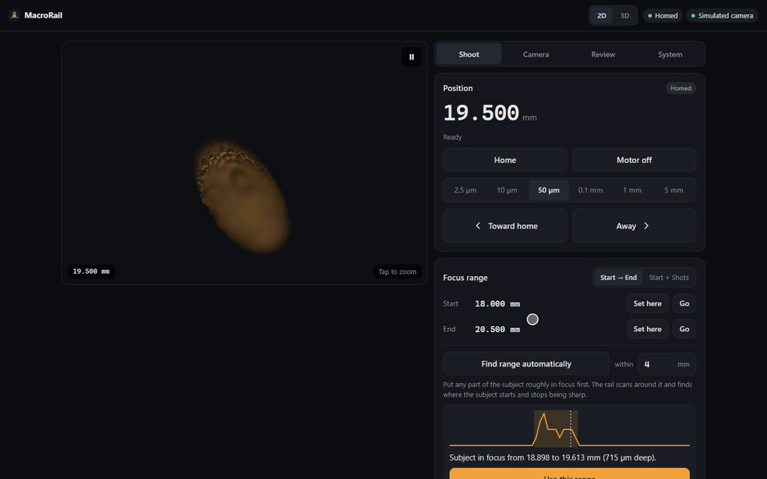
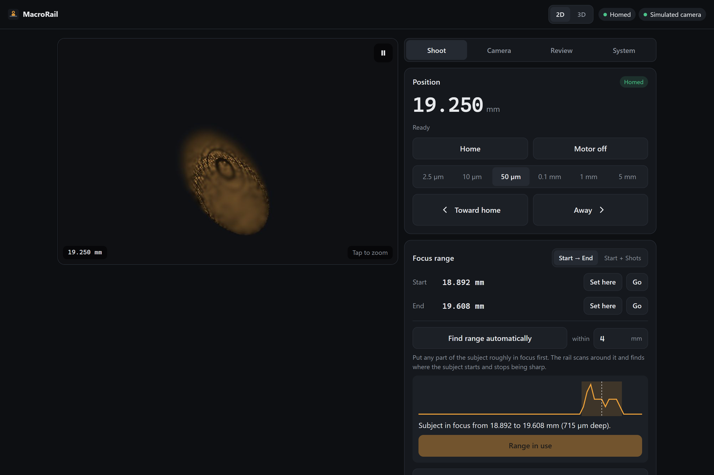
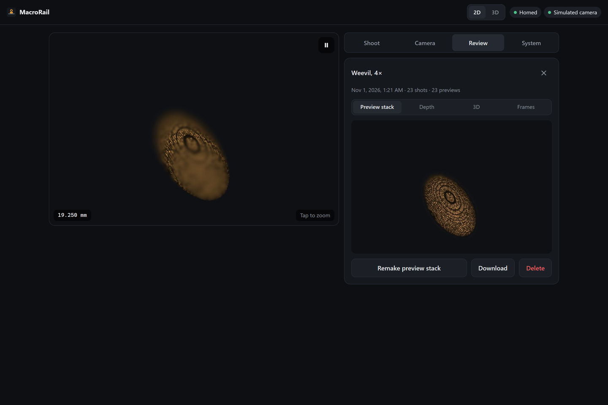
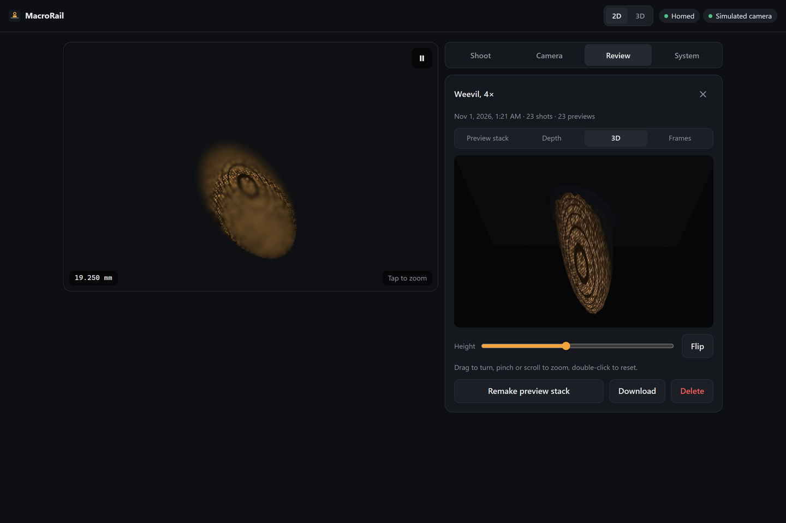
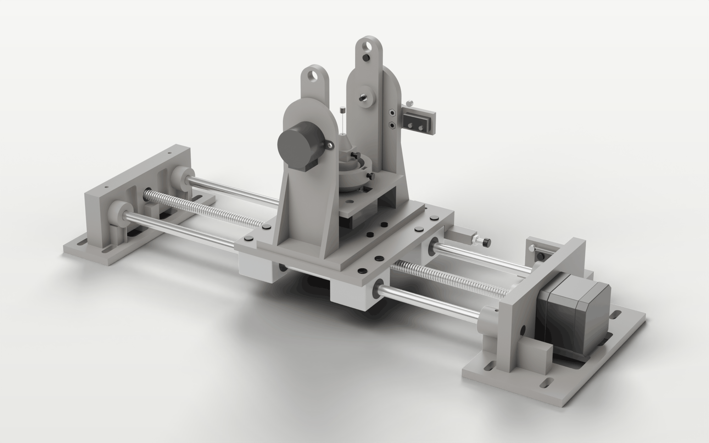
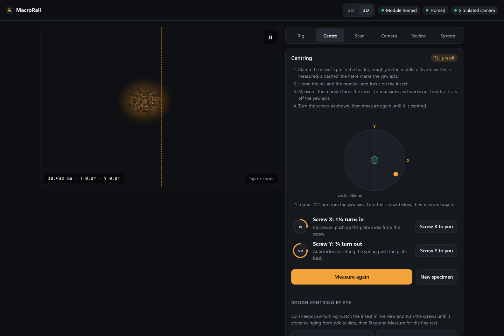
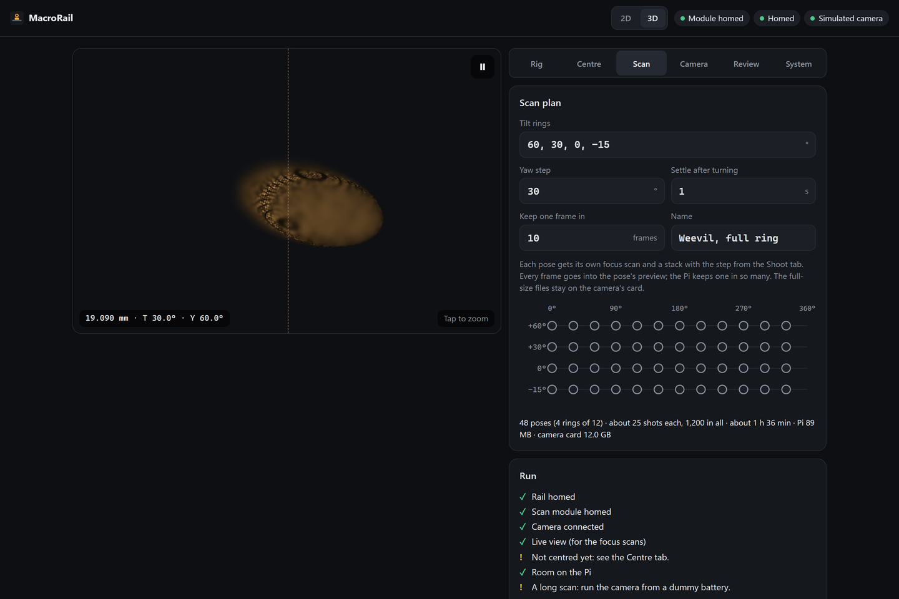
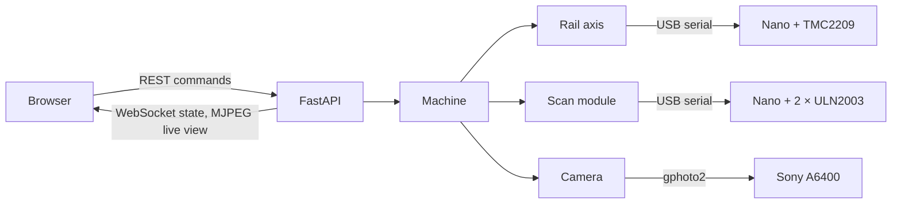

# MacroRail

[](https://github.com/Sam-de-Ham/MacroRail/actions/workflows/ci.yml)


[](https://docs.astral.sh/ruff/)
[](LICENSE)

Focus stacking for macro and microscope-objective photography. A 3D-printed rail moves the
subject in micrometre steps while the camera takes a photo at each step, and you run it from
a phone or laptop.

A Raspberry Pi serves the web app, drives the rail through an Arduino Nano and a TMC2209
stepper driver, and controls the camera over USB with gphoto2, including live view. An
optional module bolts onto the carriage to tilt and turn the subject, for multi-angle scans.



- [Features](#features)
- [Hardware](#hardware)
- [Try it without hardware](#try-it-without-hardware)
- [Install on the Raspberry Pi](#install-on-the-raspberry-pi)
- [Shooting a stack](#shooting-a-stack)
- [3D scan module](#3d-scan-module)
- [How it works](#how-it-works)
- [Development](#development)
- [License](#license)

## Features

- **Precise and repeatable.** 2.5 µm steps (1/16 microstepping on an 8 mm-lead screw) with a
  quiet StealthChop drive. Every frame is approached from the same direction, so backlash
  never shifts a slice. The home switch is interrupt-driven and always armed.
- **Nothing is assumed.** Each move is confirmed by the controller and each shot by the
  camera before the next step. A camera error pauses the stack instead of skipping a frame.
- **Quick to set up a stack.** Set start and end on the live view, or let a scan through
  focus find where the subject starts and ends. A step-size helper works out the step from
  the lens's magnification and aperture.
- **Results straight away.** Small copies of each shot appear as they are taken and are
  combined into a quick all-in-focus preview, with a rough depth map shown in false colour
  and as a 3D relief. A stack's copies download as a zip.
- **Calibrated and observable.** The lead screw's backlash is measured optically, and a
  diagnostics panel shows the motor driver, the serial link, the camera and the Pi's health.
- **Works from a phone.** A mobile-first UI that installs as an app and alerts you when a
  stack ends. One device has control at a time; Stop works from any of them.
- **Multi-angle scans** with the optional module: a centring helper, scan plans of tilt rings
  and yaw steps, a focus range and stack per pose, and an export for photogrammetry.



| Shoot | Review | Depth map |
|---|---|---|
|  |  |  |

## Hardware

There are two builds. The rail on its own is a complete focus-stacking setup; the scan
module is an add-on that bolts to the rail's carriage and has its own controller, so the
rail itself does not change.

| | Rail | Scan module (optional) |
|---|---|---|
| Mechanics | Printed frame, two 8 mm rods, four SC8UU blocks, Tr8×8 lead screw, NEMA 17 | Printed fork, tilt cradle and yaw head; two 28BYJ-48 geared steppers |
| Electronics | Arduino Nano + TMC2209 at 12 V, roller microswitch for homing | A second Arduino Nano, two ULN2003 boards, a microswitch (tilt) and a KY-024 hall sensor (yaw) |
| Build guide | [MacroRail build guide (PDF)](docs/guides/MacroRail-build-guide.pdf) | [Scan module guide (PDF)](docs/guides/MacroRail-scan-module-guide.pdf) |
| Files | [`hardware/rail`](hardware/rail) | [`hardware/scan-module`](hardware/scan-module) |

Both need a Raspberry Pi (tested on a 3B+ with Raspberry Pi OS 64-bit, Debian 13) and a camera
that gphoto2 can trigger remotely (tested with a Sony A6400 in *PC Remote* mode). Pin maps and
first power-up checks are in [`docs/wiring.md`](docs/wiring.md).

## Try it without hardware

Any machine with [uv](https://docs.astral.sh/uv/):

```bash
uv run macrorail --sim
```

Open <http://localhost:8000>. The simulator models both controllers (they speak the same
serial protocols as the firmware), the carriage and a camera whose live view sharpens and
blurs as the rail moves through focus.

## Install on the Raspberry Pi

1. **Flash the firmware** onto the Nano with [PlatformIO](https://platformio.org/), from any
   computer:

   ```bash
   pio run -d firmware -e nano -t upload
   ```

   Use `-e nano_new` for Nanos with the new bootloader. The scan module's Nano takes
   `firmware-module` in the same way.
2. **Install the app** on the Pi:

   ```bash
   git clone https://github.com/Sam-de-Ham/MacroRail.git ~/macrorail
   ~/macrorail/deploy/install.sh
   ```

   This installs uv and the dependencies, creates `~/.config/macrorail/config.toml`, and
   starts the `macrorail` service at `http://<pi-hostname>.local:8000`. The serial ports
   default to `auto`: the app finds each Nano by what it reports.
3. **Autostart** can be turned off with `sudo systemctl disable --now macrorail` (and back on
   with `enable --now`), or skipped with `deploy/install.sh --no-autostart`. Logs:
   `journalctl -u macrorail -f`.

**Camera (Sony):** set *USB Connection* to *PC Remote*. For the review previews, also set
*PC Remote Settings → Still Img. Save Dest.* to *PC+Camera* and *PC Save Img* to *JPEG Only*:
full-resolution files (RAW too, if chosen) stay on the card and a JPEG comes over USB. Set
*USB Power Supply* to *Off*: a camera charging from the Pi can pull it into under-voltage.

**As an app:** the page can be added to a phone's home screen. Browsers allow installing it,
and system notifications, only over HTTPS or on the Pi itself; over plain HTTP the stack
alerts still chime, vibrate and mark the tab title.

## Shooting a stack

1. **Home** the rail. It finds the switch, backs off until it opens plus 1 mm, touches it
   again, and parks just clear of it.
2. **Set the range.** Jog to the front of the subject on the live view and press **Set here**
   for Start, then the same for End; or bring any part of it roughly into focus and press
   **Find range automatically**. Tap the live view to zoom in.
3. **Choose a step size**, or open **Which step?**: from the magnification and numerical
   aperture it suggests half the depth of field (≈ λ/NA² + e/(M·NA)). The shot count and
   estimated time show before you start.
4. **Preview range** sweeps between the two points so you can check the framing.
5. **Start stack**, optionally named. You can pause and resume; Stop returns the rail to the
   start.
6. **Review** shows each stack's shots, the preview stack and its depth map.

Once per setup, **System → Measure backlash** (with a sharp detail in focus) measures the
lead screw's play and offers the matching take-up distance.

## 3D scan module



The module holds the insect on a pin between two uprights: one motor tilts the cradle from
−33° to +90°, the other turns the specimen about its vertical axis. Two screws centre it on
the yaw axis by hand, once per specimen. A **2D / 3D** switch in the top bar picks the
workspace; 2D stays exactly as described above.

1. **System → Scan module:** check the connection, then calibrate once: the yaw motor's steps
   per turn, and the tilt level with a straight pin in the holder.
2. **Rig:** home the module, jog tilt and yaw, or go to a pose.
3. **Centre:** focus on the insect and press **Measure**. The module looks from four sides,
   fits the offset, and shows which screw to turn and how far. Repeat until it is centred.
4. **Scan:** choose the tilt rings and the yaw step, check the estimate and the pre-flight
   list, then start. Each pose gets its own focus range and stack. A stopped scan can be
   continued, also after a restart.
5. **Review:** the poses as thumbnails. **Download for 3D** gives one all-in-focus image per
   pose, named by its angles, with depth maps and a pose table for COLMAP or Meshroom.

| Centring | Scan plan |
|---|---|
|  |  |

More in [`docs/3d-scanning.md`](docs/3d-scanning.md).

## How it works



One asyncio process owns all the hardware and runs one operation at a time; the browser only
sends commands and receives state. Each move waits for the controller's reply and each shot
for the camera's file event. The simulator replaces the serial ports and the camera and
leaves everything above them unchanged, so the tests run the real application code.

- [`docs/architecture.md`](docs/architecture.md): layers, modules and data flow, with diagrams.
- [`docs/design-notes.md`](docs/design-notes.md): the main decisions and what the hardware showed.
- [`docs/protocol.md`](docs/protocol.md) and [`docs/protocol-module.md`](docs/protocol-module.md):
  the serial protocols of the two Nanos.
- [`docs/api.md`](docs/api.md): the REST and WebSocket API.

## Development

```bash
uv sync                         # Python 3.13 environment with the dev tools
uv run pytest                   # tests, against the simulator
uv run ruff check && uv run ruff format --check
uv run mypy                     # strict type checking of src, tests and scripts
pio run -d firmware             # build the rail's firmware
pio run -d firmware-module      # build the scan module's firmware
scripts/deploy-dev.sh pi        # copy HEAD to the Pi over SSH and reinstall
```

See [`CONTRIBUTING.md`](CONTRIBUTING.md) for the rest. Renders of the hardware are made with
Blender from [`hardware/render`](hardware/render).

## License

- **Code:** [PolyForm Noncommercial 1.0.0](LICENSE). Free to use, study, modify and share for
  any noncommercial purpose. GitHub lists it as "Other" because it doesn't detect this licence.
- **Hardware designs:** [CC BY-NC 4.0](hardware/LICENSE).
