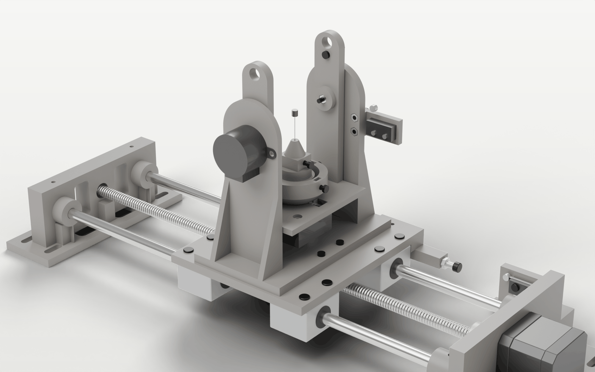
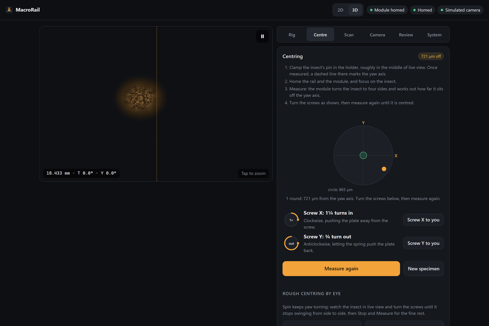
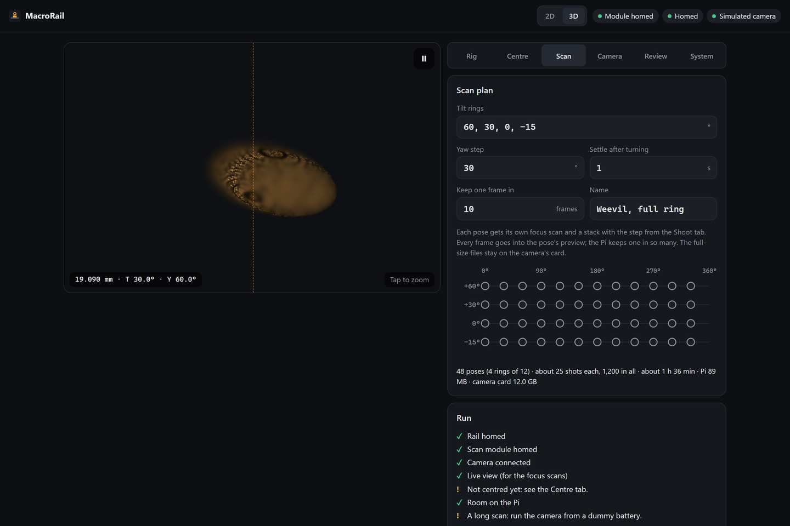

# 3D scanning

The scan module is an optional bolt-on for the rail. It holds a pinned insect on two motorised
axes, tilt and yaw, so the app can photograph it from many angles: one focus stack per pose.
The all-in-focus images, named by their angles, go to photogrammetry software (COLMAP,
Meshroom) to build a 3D model.



Without the module, the rail is the plain focus-stacking rail. The module has its own Nano on
its own USB cable, so the rail's firmware, wiring and protocol don't change, and the app's 2D
mode behaves the same whether the module is plugged in or not. A **2D / 3D** switch in the top
bar selects the workspace; it is remembered per browser.

- Hardware, print guide and CAD: [`hardware/scan-module/README.md`](../hardware/scan-module/README.md)
- Assembly, wiring and use (PDF): the [scan module guide](guides/MacroRail-scan-module-guide.pdf); pins also in [wiring.md](wiring.md#scan-module)
- Controller protocol: [protocol-module.md](protocol-module.md)
- Why things are done this way: [design-notes.md](design-notes.md#scan-module)

## The problem it solves

A pinned insect never sits exactly on the pin's axis, so when the pin turns, the insect travels
a circle. Movement along the lens axis only changes focus, and a focus scan at every pose
absorbs it. Movement across the image pushes the insect out of a 5.5 × 3.65 mm field at 4×.
Rotating-specimen rigs (DISC3D, scAnt and others) solve this the same way: centre the
specimen once, where the rotation axes cross, then rotate freely. The module does that with a
hand-adjusted centring plate and an app that measures how far to turn each screw.

## The module

```
camera ──▶ lens axis ──▶ insect (where the yaw and tilt axes cross)
                          │ pin, about 19 mm exposed
                          ├ specimen holder: nose + pin clamp (one M3 screw),
                          │   on the centring plate (X/Y screws, spring)
                          ├ yaw head on the yaw 28BYJ-48's shaft
                          └ cradle floor
cradle arms ── tilt axis ── uprights: 608 bearing on one side, tilt 28BYJ-48 on the other
base plate ── 4 × M3 ── rail carriage (focus axis, unchanged)
```

### Mounting

The fork (base plate, both uprights and their ribs, printed as one body) bolts to the four
free holes of the carriage (60 × 20 mm, Ø4.5) with M3 bolts and printed washers; the rail's
sample platform is not fitted. The base has pockets for the bearing blocks' screw heads.
The tilt axis sits 95 mm above the carriage top, so the camera's tripod sets the lens to that
height. The module is about 126 mm wide including the tilt motor.

The slop of M3 bolts in Ø4.5 holes doesn't matter: the app measures where the axes appear in
the image.

### Axes

| Axis | Drive | Range | Home |
|---|---|---|---|
| Tilt | 28BYJ-48, direct drive, on the outside of one upright; a printed axle in a 608 bearing on the other | −33° (belly towards the lens) to +90° (top view) | Roller microswitch on a printed bracket, tripped by a flag bolt on the cradle at about +97°, away from the lens |
| Yaw | 28BYJ-48 under the cradle floor; the head sits straight on its shaft | Unlimited (nothing electrical turns with the head) | KY-024 linear hall board under a Ø5.7 mm magnet in the head; homes on the field peak |
| Centring X/Y | Two M3 button-head screws at 90°, turned with a 2 mm hex key; a pen spring pushes back | ±2.5 mm, 0.5 mm per turn | Set by hand, once per specimen |
| Height | The pin slides in the holder; a printed stepped gauge (17–21 mm) sets it | Set by hand | Measured by the app |

Angles in the app: tilt 0 is level, positive turns the insect's back towards the camera; yaw
is counter-clockwise seen from above, and 0 is where the magnet passes over the hall sensor.
At yaw 0 centring screw X points at the camera, and screw Y is 90° counter-clockwise from it.

Tilt is limited by the 4× objective's 12 mm working distance: a CAD sweep of every moving part
against the objective plus 2 mm gives −33° on the belly side with 1.1 mm to spare. The limits
are enforced by both the app and the module's firmware. Until the tilt switch's angle has been
calibrated, tilt stops at −20°.

### Specimen holder

The centring plate, a clamp column and a 45° tapered nose are one printed part. The pin
(sizes 00 to 1, 0.30–0.40 mm) passes through a Ø1.2 hole in the nose and the column and is
pinched by one M3 screw through a captive nut. Specimens are changed by swapping the pin; the
holder stays in the head. Insects glued on the pin tip and insects pinned through both work.

The holder sits in a ring on the yaw head between the two screw tips and the spring. A 4 mm
V in its rim captures the screw ends, so the plate can't lift.

### Torque

The cradle hangs below the tilt axis like a pendulum and needs about 40 mN·m at 90°. The
28BYJ-48's gearbox friction (listed at 60–120 mN·m) holds it unpowered, so the coils are
switched off between moves and no heat reaches the specimen. Lifting is closer to the limit
(pull-in torque about 34 mN·m, more at slow speed). If tilt loses steps near +90° (homing on
the switch shows it), the cradle arms have Ø8.3 holes 38 mm above the axis for an 8 mm rod
with nuts as a counterweight.

## Electronics

A second Arduino Nano runs the module ([`firmware-module/`](../firmware-module/)). Two ULN2003
boards drive the 28BYJ-48s from a separate 5 V supply whose ground is shared with the Nano;
the Nano's USB 5 V can't carry two motors at about 240 mA each.

| Signal | Module Nano pin |
|---|---|
| Yaw ULN2003 IN1–IN4 | D2, D3, D4, D5 |
| Tilt ULN2003 IN1–IN4 | D7, D6, D9, D11 |
| Tilt switch (C → GND, NO → pin, internal pull-up) | D10 |
| KY-024 analogue output | A0 |

The pins are constants in `firmware-module/src/config.h`. Flash it with
`pio run -d firmware-module -e nano -t upload` (`nano_new` for a new-bootloader Nano).

Both Nanos are CH340 clones that share a `/dev/serial/by-id` name, so set `port = "auto"` for
both `[rail]` and `[module]` in `config.toml` (the default) or give each a
`/dev/serial/by-path/...` path. With `auto`, the app tells them apart by their first line.

**System → Module test** (3D workspace) shows every raw reading (switch, hall, half-steps,
link) and has a forward and back button per motor, for checking the wiring before homing.

## Moving the axes

The Rig tab homes the module (tilt first, then yaw, or either alone), jogs each axis, goes to
typed angles and has quick poses: Level, Top view, Belly view (the lowest allowed tilt), and
Screw X / Screw Y to you. Gauges show the cradle's tilt with the no-go zone and the head's yaw
with the screws marked; the live-view corner shows the angles beside the rail position.
Before tilt is homed, a tilt jog is limited to 10°, since the app can't yet tell where the
lens is.

## Calibration

Two measurements, once per machine, in the System tab (3D workspace). The results are stored
in `module.json`.

- **Measure yaw turn.** Homes yaw, turns three turns, homes again; where the second homing
  finds the magnet gives the half-steps per turn. The 28BYJ-48's gear ratio is not an integer
  and varies between units (nominal 4075.77; the built module's yaw measured 4096.33). A
  result more than 2 % from nominal is refused, since it means the head slipped on its shaft.
- **Level tilt.** With a straight needle upright in the holder and in focus, the app sweeps
  focus at +10° and −10° (each at yaw 0° and 180°) and computes the switch's true angle from
  how far the needle's top and bottom focus apart. Afterwards tilt is level and opens to its
  full range (−33°).

The tilt motor keeps the nominal gear ratio; its calibration measures only the angle offset.

## Centring



Centring puts the insect on the yaw axis. It is done by hand, with the app measuring, and
usually takes two rounds.

1. **Mount** the pin in the holder, set its height with the gauge, and tighten the clamp
   screw. Home the rail and the module, and focus roughly on the insect.
2. Optionally **Spin**: yaw keeps turning (up to 100 turns, until Stop) while you watch live
   view and turn the screws by eye for a rough start.
3. **Measure.** The app turns yaw to 0°, 90°, 180° and 270°. At each angle it focuses and
   finds the insect across the image (the detail-weighted centre of the sharpest frame). A
   circle fit gives the offset from the yaw axis and where the axis appears in the image,
   drawn as a dashed line in live view.
4. **Turn the screws.** The advice is in eighths of a turn, with a dial per screw. A button
   turns the head so that screw faces you, by default 45° beside the objective (the access
   angle is a setting, since the camera side is where you stand).
5. **Measure again** until the offset is under 0.1 mm.
6. **Height.** The app focuses at +20° and −20° tilt and says how far to push or pull the pin.

Each round also checks the previous advice: if a screw moved the plate the opposite way, its
direction is flipped and stored, so the next advice is right. **New specimen** clears the
rounds and height for the next insect.

## Scans



A scan is a ring of yaw angles at each of several tilts. The default plan is tilts +60°, +30°,
0° and −30° with a yaw step of 36°: 40 poses. Rings run from the top down, and within and
between rings yaw only turns forwards, so every arrival takes up the gear backlash the same
way.

At each pose the app:

1. turns the module to the pose and waits (1 s by default);
2. runs a focus scan (auto range) to find the insect's front and back; if it finds nothing,
   it uses the last range found;
3. shoots an ordinary focus stack through that range with the 2D step size, using the same
   code as the Shoot tab (take-up, settle, camera retries, previews);
4. builds the pose's preview stack and depth map, and keeps every tenth frame on the Pi
   (configurable) to save space.

Before a scan starts, a pre-flight list checks that the rail and the module are homed, the
camera and live view are available, there is room on the Pi, whether the specimen has been
centred, and reminds you to use a dummy battery for long scans. The tab shows the number of
poses and shots, the time, and the space needed on the Pi and on the card.

- **Test this pose** runs one pose at the module's current angles: a quick check of focus,
  range and exposure.
- **Pause, Resume, Stop** work as for a stack. The top bar's Stop stops the scan.
- **Continue.** The record (`scans/<id>/scan.json`) is written after every pose. After a stop
  or a restart, Continue homes yaw again and skips the poses that are done. If the very first
  pose finds no range, the scan stops so you can focus, then continue.
- The step, the stack settle time and the focus span are fixed in the scan's record at the
  start, so a continued scan shoots the remaining poses the same way.

As a rough guide at 4× (32.5 µm step) with 2.5 mm of depth per pose, a pose is about 78 shots
and four to five minutes, so the default plan takes around three hours and about 30 GB of
full-size JPEGs on the card.

### Manual tilt

To set tilt by hand instead of with its motor, turn on **Manual tilt** in the System tab. Tilt
then needs no homing and its controls are hidden. Centring works at whatever tilt the cradle
is set to. A scan pauses before each tilt ring with an alert ("Set the tilt to 30° by hand,
then press Resume") and turns only yaw. Levelling tilt and the height measurement need the
motor and are not available.

## Review and export

The 3D Review tab lists scans. Each pose's thumbnail opens the usual stack viewer: preview,
depth map, 3D relief and frames. Pose stacks don't appear in the 2D Review.

**Download for 3D** streams a zip:

```
MacroRail-scan-<id>/
  images/pose-001_tilt+060_yaw000.jpg   one all-in-focus preview per pose (1600 px)
  depth/pose-001_tilt+060_yaw000.png    16-bit depth map (white = first shot)
  depth/pose-001_tilt+060_yaw000-colour.jpg
  poses.csv                             pose, tilt, yaw, image, stack, shots, first and last camera file
  scan.json                             the full record: plan, poses, results, camera file names
  about.json                            angle conventions and what the files are
```

The `images/` folder can go straight into COLMAP or Meshroom for a draft model. For full
quality, stack the full-size files from the camera's card per pose (Zerene Stacker, Helicon
Focus) using the file names in `poses.csv` and `scan.json`, and reconstruct from those.

## Limits

- **Field of view.** At 4× the field is 5.5 × 3.65 mm, so insects larger than about 5 mm
  don't fit. There is no tiling; use a lower magnification for larger specimens.
- **Belly views.** The lens limits tilt to −33°, so the underside is seen at a shallow angle
  at best.
- **Yaw wobble.** The head sits directly on the 28BYJ-48's shaft without a bearing. Shaft play
  gives a small, repeatable wobble, well inside the frame after centring.
- **Centring is manual** and is repeated for every specimen. The height is set with the gauge.
- **Auto range per pose** has had limited testing on real subjects; a pose that finds nothing
  falls back to the last range.
- **Previews are quick stacks** (sharpest pixel per frame) at 1600 px. They are enough for a
  draft reconstruction; a full-quality model needs the full-size files stacked elsewhere.
- **Time and wear.** A full scan takes hours and thousands of shutter actuations. The camera
  should run from a dummy battery, with its USB power supply set to Off (see
  [design-notes.md](design-notes.md#power-on-the-pi)).
- **Lighting** is not part of the module.

## Possible extensions

- Motorised centring: two more 28BYJ-48s on the X/Y screws through hex-bit couplers. That
  needs more pins than a Nano has (an ATmega2560 board would do).
- A 608 turntable under the yaw head, if the shaft wobble turns out to matter.
- Tracking the insect between poses from the sharp tiles, and tiling for larger specimens.
- A live-view draft scan: sweep focus at each pose without the shutter, to check coverage in
  minutes.
- Cross-polarised lighting: polariser film on each light and an analyser behind the
  objective, with any diffuser before the film.
