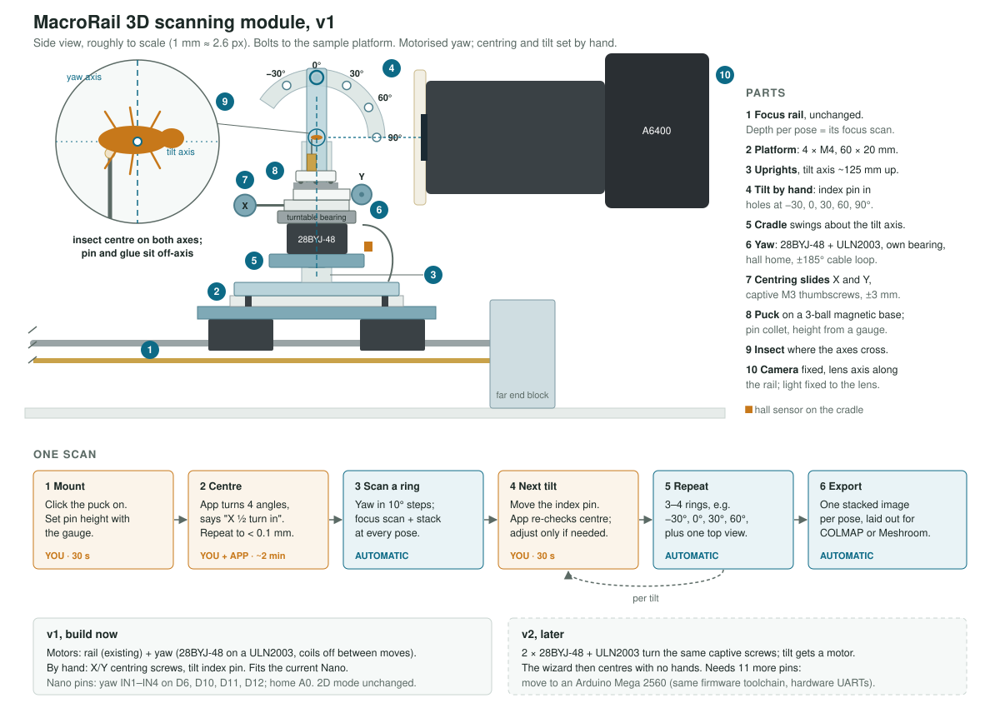

# 3D scanning: design direction

The plan for the next major version: a full 3D scan of a pinned insect, driven by the
existing focus rail. Chosen with the user on 2026-10-21. Nothing here is built yet.

## Ground rule: 2D stays exactly as it is (user, 2026-10-21)

The rail must always work for normal focus stacking, exactly as it does today.

- **Branch:** all 3D work lives on `3d-scanning`. `main` stays the working 2D version.
  Merge only when the user agrees.
- **Mode switch:** the app gets a 2D/3D switch. 2D mode is today's app, unchanged.
  3D mode reuses the same UI patterns and components for the 3D workflow.
- **No 2D differences unless agreed.** Anything that shows in 2D mode needs the user's
  yes first: UI, behaviour, defaults, settings, stack records, rail firmware behaviour.
  If a 2D change looks worth it, propose it ("what about…?") and wait.
- **Shared code:** refactoring shared code is fine only if 2D behaviour stays identical,
  the existing tests still pass unchanged, and the refactor is mentioned to the user.
- **Firmware:** the yaw axis is purely additive. The firmware must run the rail normally
  with no yaw motor plugged in, and rail commands keep their current meaning.
- **Hardware:** the module bolts onto the platform. Without it, the rail is today's rail.

## Working together

The user and the agent do the whole build together, step by step: plan, measure, model
in CAD, print, program, set up, calibrate. Measurements come from the user. The rail's
own geometry comes from the STLs in `hardware/rail/stl/`.

## The problem

An insect glued to a pin is never on the pin's axis, so when the pin turns, the insect
travels a circle. Movement along the lens axis only changes focus, and running the focus
scan at every pose absorbs it. Sideways (and, once tilted, vertical) movement pushes it out
of frame. The frame is small: at 3× the A6400's 23.5 mm sensor sees 7.8 mm, so a 4 mm
insect has only ±1.9 mm of room. Earlier attempts (rotate + focus; rotate + tilt on the
rail) failed for this reason.

Photogrammetry doesn't need the insect centred, only whole and sharp in every view.

## What others do (research, 2026-10-21)

- **DISC3D** (Ströbel et al. 2018): two-axis gimbal; the mount is adjusted by hand to the
  gimbal's centre of rotation. Camera on a StackShot rail, 398 usable poses.
- **scAnt** (Plum & Labonte 2021): yaw + tilt gimbal, centred by hand; the stack range is
  set wide enough to cover the remaining wobble.
- **CSIRO prototype** (Nguyen et al.): two laser pointers mark the rotation centre; the
  specimen is moved until both hit it.
- **Orbitoscope** (2026): specimen fixed, camera on an XYZ gantry plus two rotations;
  42–67 h per specimen. Not a fit for a rail project.
- **Crystallography goniometer heads**: cross-slides under the pin bring the sample onto
  the axis; motorised heads centre themselves.

Every rotating-specimen rig centres once, on the rotating part, then rotates freely.
None corrects the drift with extra linear axes during the scan.

The full study (concepts A–G, tolerance chart, 3D model, scan-time calculator) is a
private page: https://claude.ai/artifact/Rirv3GTEdBBLdavVmZ82GV

## Decision: v1

A module that bolts to the sample platform (4 × M4 on the 60 × 20 mm pattern):

| Part | v1 | Notes |
|---|---|---|
| Focus | Existing rail | Per-pose focus scan + stack, as today. |
| Yaw (about the pin) | **Motor**: 28BYJ-48 + ULN2003 | Drives a turntable on its own bearing (see below). Hall sensor home. ±185° travel with a cable loop, so no slip ring. |
| Tilt (about the sideways axis) | **By hand** | Index pin in holes at −30°, 0°, 30°, 60°, 90°. Exact angles don't matter: SfM solves the camera poses. Tilting the belly toward the lens swings the cradle into it, so that side stops near −35°. |
| Centring X/Y | **By hand**: two printed dovetail slides, captive M3 screws, ±3 mm | 0.5 mm per turn; a quarter turn is 0.125 mm, and ±0.2 mm is plenty. Spring preload so they can't rattle. |
| Height | Pin collet + printed gauge | Puts the insect on the tilt axis. |
| Specimen | Puck on a 3-ball magnetic kinematic base | Swaps in seconds; it goes back in the same place, so the centring is kept. |

Why tilt about the sideways axis: tilt then moves things only in depth and vertically.
Tilting about the lens axis would roll the insect sideways across the frame.

The insect's centre goes where the yaw and tilt axes cross. There it stays in place for
every yaw and tilt, so it is centred once per specimen. Each tilt change gets a quick
check, adjusted only if the pin height was off.

### One scan

1. Mount the puck, set the pin height with the gauge (you, 30 s).
2. Centring wizard: the app turns the insect to 4 yaw angles, finds it in the live view
   (sharp tiles) and with a focus scan, fits a circle, and says how far to turn each screw.
   Repeat until the offset is under ~0.1 mm (you + app, ~2 min).
3. Scan a ring: yaw in 10° steps, focus scan + stack at each pose (automatic).
4. Move the index pin to the next tilt; the app re-checks centring (you, 30 s).
5. 3–4 rings plus a top view (automatic).
6. Export one stacked image per pose for COLMAP or Meshroom (automatic).

Math for the wizard: at yaw θ, an offset (x, y) shows sideways as x·cos θ − y·sin θ and in
depth as x·sin θ + y·cos θ. With equally spaced angles the least-squares fit is a plain
Fourier sum. The image gives the sideways curve precisely; the focus scan's depth curve
is a cross-check. The machine's own axis positions in the image are measured once with a
calibration needle on a puck and stored in `config.toml`.

### Yaw motor: 28BYJ-48, not NEMA 17 (decided 2026-10-21)

- **Why:** about 35 g against about 280 g, and 28 mm across. A light, small cradle swings
  more easily by hand, sits closer to the tilt axis and clears the lens better. It gives
  2048 steps per turn (0.18°), and its torque is ample for a puck and slides.
- **Its weak points, and how the design handles them:**
  - *Gearbox backlash (about a degree):* every pose is approached turning the same way,
    the same trick as the rail's take-up. Rings run one way; going back unwinds past the
    start and approaches it again forwards.
  - *Loose output shaft:* the turntable gets its own bearing, and the motor only turns it
    through a coupler. Hanging the head on the shaft would let it rock. With the insect
    30 mm up, 0.5° of rock is 0.26 mm sideways.
  - *Heat from holding current:* the coils switch off once a move ends; the gearbox holds.
    A warm motor under the insect would drift it through thermal expansion and air shimmer.
- **Driver:** a ULN2003 board, as supplied (no rewiring). A TMC2209 with the 28BYJ's
  bipolar modification would be quieter and smoother; it stays an option.

### Nano pins (v1)

Used today: D2 home, D3 STEP, D4 DIR, D5 EN, D7/D8 driver UART, D9 reserved (relay).
Yaw takes ULN2003 IN1–IN4 on D6, D10, D11, D12 and the home sensor on A0. That leaves D13
and A1–A5.

### Print fits known from the lens-mount project

Prusa i3 MK3. These were validated in PLA and used in PETG.

- M3 clearance hole 3.4 mm.
- M3 nut pocket 5.7 mm across flats × 2.6 mm deep, for nuts measured at 5.2 mm across flats.
- Friction-fit bore: +0.6 mm on diameter ("very good grip").
- Sliding tongue in a slot: 0.4 mm total clearance, "nothing rocks".
- Rules from that project: no threads in plastic (nuts or inserts), counterbores rather
  than countersinks, and PETG creeps, so re-check bolt tension.
- M3 button-head bolts on hand: roughly 11.8, 17.5, 19.4 and 27.7 mm long. Whether those
  are under-head or overall lengths is unclear.

## Later: v2, hands-off centring

- The same captive screws get **2 × 28BYJ-48 + ULN2003** instead of knobs. That's fine
  for this job: the moves are short and happen once per scan, the 1:64 gearbox is
  slow but very fine on a 0.5 mm screw, and its backlash is a few µm there. The wizard
  closes the loop through the camera, so no limit switches. The cost: about 35 g each
  and 10 wires on the yaw. Design v1's knobs so a motor bracket and coupler can replace
  them.
- Tilt gets a motor (NEMA 17, 1:4 GT2 belt, counterweight, home switch).
- Pins: 2 × 4 for the ULN2003s plus 3 for tilt is 11, and after v1 the Nano has 6 left. Move to an
  **Arduino Mega 2560**: the same AVR toolchain, plenty of pins, and hardware UARTs, which
  would also remove the half-duplex SoftwareSerial workaround for the drivers.
  Not the Pi's GPIO: motion stays in the firmware (one owner per device).
- Optional: track the insect between poses from the sharp tiles and nudge the slides.

## Scan time (rough)

About 120 poses (10° yaw, rings at −30/0/30/60 thinned by cos(tilt), plus a top view).
At 2.5 mm visible depth and a 20 µm step that's ~126 shots per pose: ~15,000 shots,
~10 h and ~86 GB of JPEGs at 2.4 s per shot. A draft mode that sweeps the rail slowly
while grabbing live-view frames (1024 × 680) would take ~45 min with no shutter
actuations, which is good enough to check coverage before the full run.

## Software (sketch, against the current layout)

- `motion/`: a rotary `Axis` for yaw (later tilt); the protocol gains an axis name.
- `scan/` (new): scan plan (rings × yaw, the lens keep-out zone), the centring fit, and a
  runner doing rotate → focus scan → stack per pose. `focus/` already reruns per angle.
- `review/`: a folder per pose, a pose table, export for COLMAP/Meshroom.
- Moving the sample changes magnification slightly during a stack. DISC3D corrects this
  with calibrated scaling, which matters for true-scale models.

## Open questions for the user

- Lens and magnification range (these set the working distance, cradle size and tilt
  limits).
- Typical specimen length; glued to the pin tip or pinned through the thorax?
- Parts from the earlier rotate-and-tilt build that could be reused.
