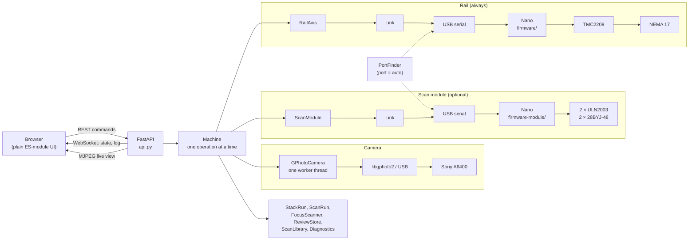
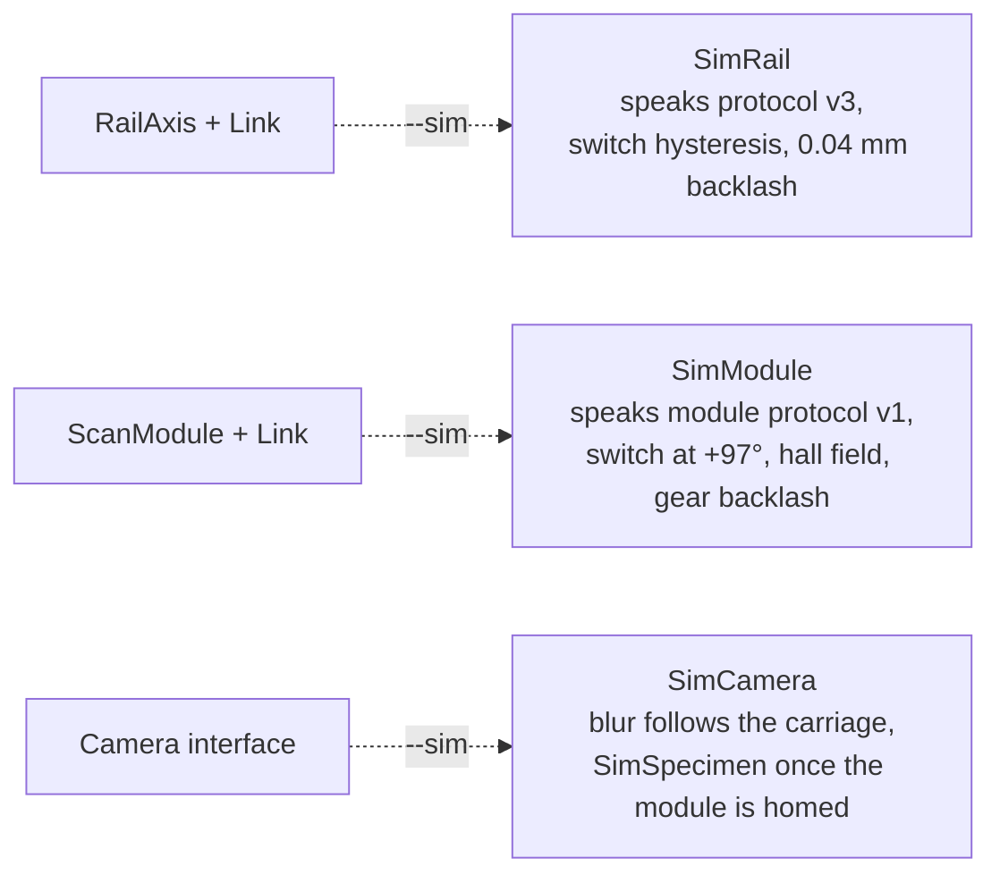
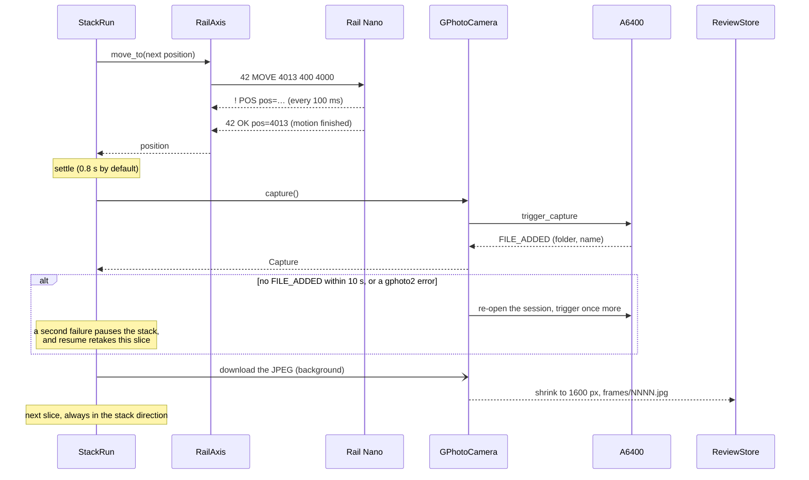
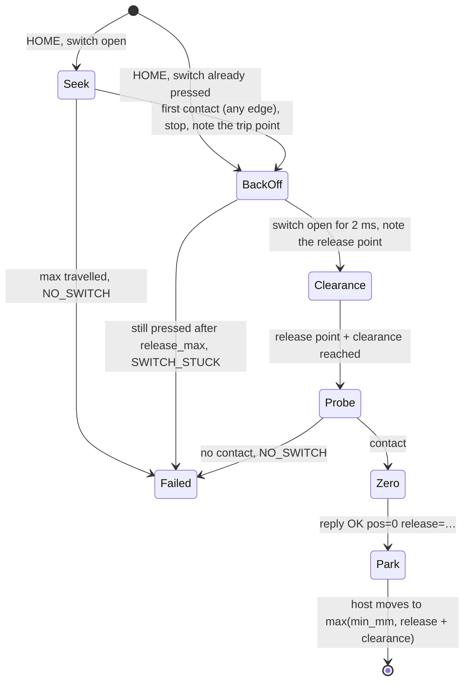

# Architecture

One Python process on the Raspberry Pi owns all the hardware: the rail's Nano, the scan
module's Nano (when fitted) and the camera. Browsers send commands over REST and receive state
over a WebSocket; they never talk to hardware.

With `--sim` the transports and the camera are swapped for simulators; everything above
them is the production code:

## Principles

- **One owner per device.** Only this process opens the serial ports and the camera.
  `Machine` runs one operation at a time. While one runs, only Stop (accepted from any
  device) and Pause/Resume of a running stack or scan are accepted.
- **One controlling browser.** The first browser to connect holds control (its client id in
  the `X-Client-Id` header); the others watch until they take it over. Stop works from any.
- **Never act on assumptions.** A move is done when the controller replies, a shot when the
  camera reports the new file. Positions come from the controllers.
- **Push, don't poll.** Every change produces one state snapshot, pushed over the WebSocket
  (at most 20 per second per client). Defaults live only in the backend.
- **Same code for the simulator and the hardware.** The simulators speak the real serial
  protocols; the test suite runs against them.

## Layers

| Module | Responsibility |
|---|---|
| `motion/protocol.py`, `motion/link.py` | Line protocol ([protocol.md](protocol.md)). Requests carry ids, so replies can't be mismatched. A missing reply means the link is dead, and it is rebuilt. |
| `motion/ports.py` | `port = "auto"`: finds each Nano by its `READY` line (the module's carries `role=module`). |
| `motion/rail.py` | The rail as an `Axis`: connection supervision, status polling (which doubles as the controller's watchdog), homing, moves, errors in plain language. |
| `motion/module.py` | The scan module ([protocol-module.md](protocol-module.md)): tilt and yaw in degrees, homing, soft limits, `Geometry` (half-steps ↔ degrees from the calibration). |
| `camera/gphoto.py` | gphoto2 session on one worker thread: trigger, wait for `FILE_ADDED`, re-open and retry once; live-view frames; settings. |
| `stack/plan.py`, `stack/runner.py` | Pure planning on the microstep grid; the runner: move, settle, shoot, confirm; pause, resume, stop and return. Downloads each shot's JPEG in the background. |
| `focus/` | Focus scans: per-tile sharpness from live view at each rail position. Auto range (where the subject starts and ends) and backlash measurement (curve shift). |
| `review/` | The Pi's copy of each stack: record, 1600 px frames, a preview stack and its depth map, streamed zips. |
| `scan/` | 3D: `pose.py` (arrivals with backlash take-up), `calibrate.py`, `centring.py` (circle fit, screw turns), `measure.py`, `plan.py` (poses, estimate), `runner.py` (`ScanRun`), `library.py` (scan folders, export zip). |
| `optics.py`, `diagnostics.py` | Depth of field and the suggested step; Pi, link, driver and camera health every 5 s (the driver only while the rail is idle). |
| `machine.py` | Commands and their preconditions, the backlash-aware approach, motor current policy, settings persistence, the 3D operations. |
| `api.py`, `web/` | REST, WebSocket and MJPEG ([api.md](api.md)); a UI with no build step, one module per tab; installable (manifest and a service worker without caching). |
| `sim/` | `SimRail`, `SimModule`, `SimCamera`, `SimSpecimen` (a ray-cast insect or needle). |
| `firmware/`, `firmware-module/` | The two Nanos: step generation (AccelStepper), homing state machines, soft limits, link watchdog; the rail's also configures the TMC2209 over UART and checks it for faults. |

## One stack shot

The stack runner first approaches the start from the stack direction (overshooting by the
take-up if needed), then repeats this for every slice:

After the last shot (or Stop) the rail returns to the start, and the preview stack and depth
map are built from the downloaded frames.

## Rail homing

The sequence runs in the firmware; the host only sends `HOME` with its speeds and distances
and parks afterwards.

- Seek and probe both run at `homing_speed_mm_s` (2 mm/s); the back-off allows up to
  `homing_release_max_mm` (5 mm), then `homing_clearance_mm` (1 mm) further.
- The probe's contact becomes position 0. `release` is how far past the trip point the switch
  opened again (its hysteresis); the host logs it.
- Stop or a 2 s link silence ends any phase with `ERR STOPPED` or `ERR LINK`, and the rail
  stays unhomed.

The scan module homes tilt the same way, away from the lens, and also rejects a probe contact
that comes earlier than the seek's trip point (`SWITCH_EARLY`). Yaw homes on the field peak of
a hall sensor; see [protocol-module.md](protocol-module.md).

## Where things are stored

| Path (on the Pi) | Holds |
|---|---|
| `~/.config/macrorail/config.toml` | Hardware constants: ports, travel, homing, tilt limits ([example](../deploy/config.example.toml)). |
| `~/.local/share/macrorail/settings.json` | User settings: speeds, currents, take-up, stack start/end/step, optics. |
| `~/.local/share/macrorail/module.json` | The scan module's calibration and what centring has learnt. Kept apart, so `settings.json` stays readable by a build without the 3D workspace. |
| `~/.local/share/macrorail/scan-plan.json` | The 3D scan plan: tilt rings, yaw step, frames kept, manual tilt. |
| `~/.local/share/macrorail/stacks/<YYYYmmdd-HHMMSS>/` | One stack: `stack.json`, `frames/`, `preview.jpg`, `depth.png`, `depth-colour.jpg`. |
| `~/.local/share/macrorail/scans/<id>/scan.json` | One 3D scan's record; each pose's stack is an ordinary stack folder tagged with the scan. |

With `--sim` the data lives in a `sim/` subfolder of the same paths.

## Motion decisions

The reasons behind these are in [design-notes.md](design-notes.md).

- **Backlash.** Every arrival at a start or end point ends with a move in the stack direction
  (overshooting first if needed), and a stack only moves forward. The scan module does the
  same with its gears: tilt always arrives from above, yaw turning counter-clockwise.
- **Current.** The driver runs at full current from the first move of an operation until it
  has been idle for 30 s (default), then drops to the hold current. The current never changes
  between frames of a stack.
- **StealthChop at 1/16 with 256× interpolation:** 2.5 µm per microstep with the Tr8×8 screw.
  CoolStep and StallGuard are off; homing uses the microswitch.
- **Motors off means position unknown.** Disabling clears the homed flag, so nothing absolute
  moves until the rail is homed again.
