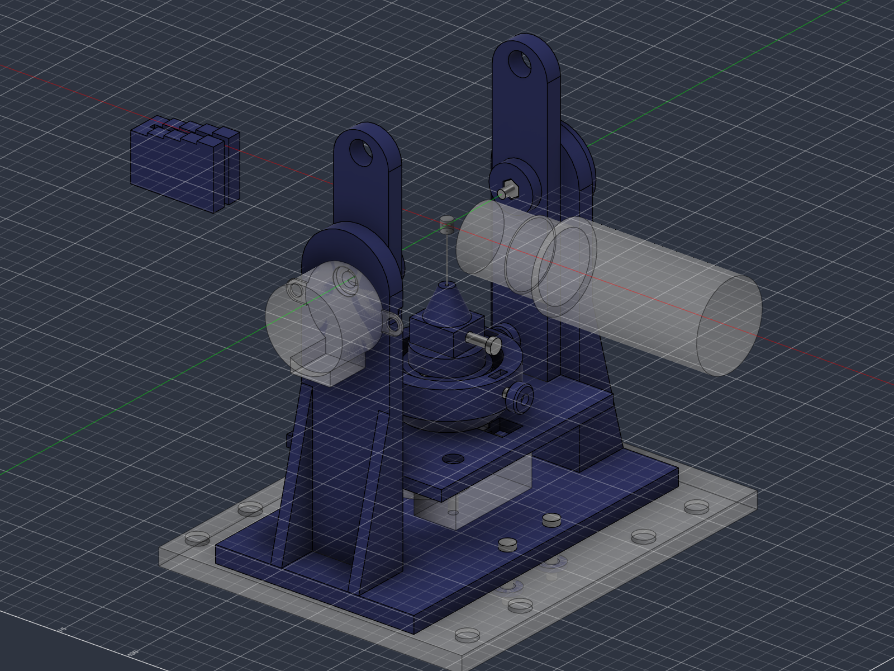
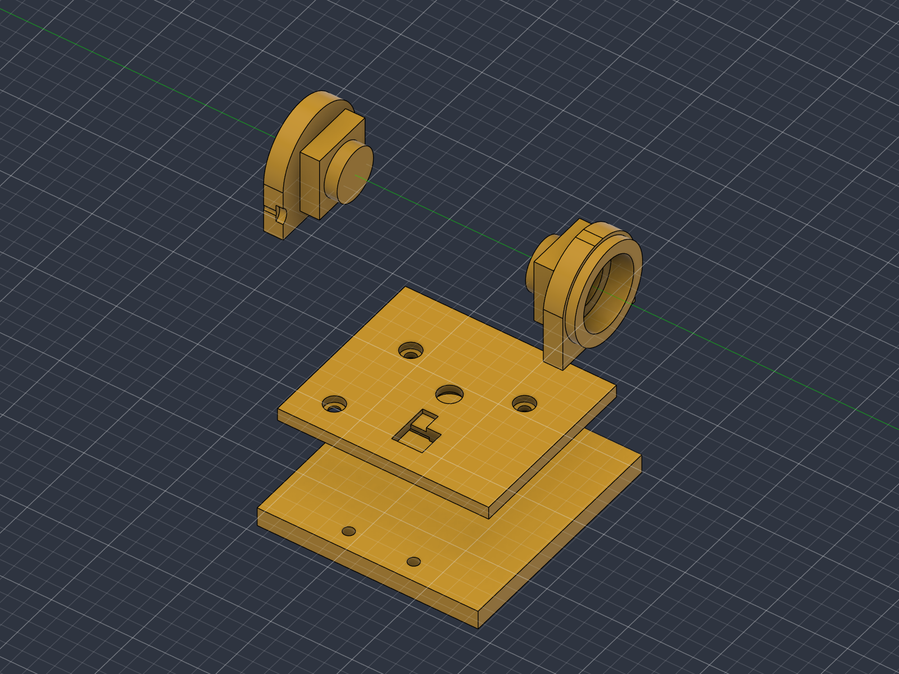

# Scan module: CAD model

The 3D-scanning module for the MacroRail, modelled in Fusion 360 (document
**3d scanner macro v1.1**, project *Everything*, folder *Useful*). The design and its reasons
are in [`docs/3d-scanning.md`](../../docs/3d-scanning.md); measurements are in
[`MEASUREMENTS.md`](MEASUREMENTS.md).

## How the model is built

- **Scripts are the source.** Every feature comes from the stage scripts in [`fusion/`](fusion/),
  run in order through the Fusion MCP. The whole model has been rebuilt from an empty timeline
  with them, with an identical result: 51 bodies, every feature healthy, every sketch fully
  constrained. To rebuild, run each stage as a script that does
  `runpy.run_path(<stage file>)['run'](context)`:

  | Stage | Builds |
  |---|---|
  | `stage_01_params.py` | All user parameters (MEAS = measured, REF = reference only) |
  | `stage_02_reference.py` | Carriage, objective + lens keep-out, insect, pin, 608, both motors, KY-024, hall sensor |
  | `stage_03_fork.py` | Fork (base + uprights + ribs, 608 seat, tilt motor seat) |
  | `stage_04a_cradle.py`, `stage_04b_cradle_floor.py` | Cradle (arms, tilt hubs, counterweight holes, floor seats) |
  | `stage_05a_head.py` … `stage_05d_knobs_hardware.py` | Yaw head (bell hub, ring), spring housing, plunger, snap-off fin, centring plate, knobs, head hardware |
  | `stage_06_puck.py` | Puck (kinematic seat, clamp column, nose), pin pad, pad screw |
  | `stage_07a_axle_washers.py`, `stage_07b_gauge.py` | Tilt axle, spacer, carriage washers and bolts, height gauge |
  | `stage_08_present_pose.py` | Appearances, selection sets, the two pose moves |
  | `stage_09_test_pieces.py` | Test pieces (slices of the real bodies) |
  | `verify_*.py` | Clearance sweep, interference, sections |

- **Parameters first:** 190+ user parameters. Change a parameter, not a feature: everything is
  driven by expressions (for example `d_floorTop = d_hubBot + gap`).
- **Coordinates:** origin at the insect, where the yaw and tilt axes cross. X runs along the
  lens axis towards the camera, Y along the tilt axis, Z up. `d_*` parameters are depths
  below the insect.
- **Bodies, not components.** Names: printed parts plainly (`Fork`, `Cradle`, `Yaw Head`, …),
  reference geometry `REF …`, test pieces `TP …`. Features and sketches have part prefixes
  (`FK`, `CR`, `HD`, `SP`, `PT`, `KN`, `PK`, `PD`, `AX`, `AS`, `WS`, `GG`, `TP`).
- **Selection sets:** `1 Printed Parts`, `2 Hardware`, `3 Reference`, `4 Lens Keep-out`,
  `5 Test Pieces`.
- **Poses:** `pose_tilt` (+ means the back of the insect turns towards the camera) and
  `pose_yaw` drive two Move features at the very end of the timeline. Keep both at 0 for
  export. Add new features *before* `POSE Yaw`.

## Verified (2026-10-21)

- **Lens clearance sweep** (tilt × yaw every 45°, every moving body against the objective
  plus 2 mm):
  - Back side: free to +90° (checked to +100°), at least 10.8 mm from the zone.
  - Belly side: −33° keeps 1.1 mm to the zone (3.1 mm to the glass). The pin, the nose and
    the spring housing reach the zone at about −35°. **Software tilt limits: −33° to +90°.**
- **Moving vs fixed:** the cradle never comes closer to the fork than the 1 mm design gap,
  at any tilt. The yaw head clears the cradle all the way round (1 mm, hub to floor).
- **Interference at rest:** only the intended overlaps remain. These are the four screws
  through their nuts, and the pin under its pad, which is modelled centred though the pad
  pushes it 0.1 mm aside.
- **Hall sensor:** sits 0.8 mm under the hub magnet at the home angle.
- **Sections** (saved, hidden): `SEC Stack XZ`, `SEC Tilt Axis YZ`, `SEC Carriage Bolts YZ`,
  `SEC Yaw Motor Bolts XZ`. They were checked for seats, wall thicknesses and bolt stack-ups.
- **Parameter stress test:** 11 key parameters changed at once (arm gap, plate size, pin
  length, axis height, hole spacing, motor tab spacing, bearing, magnets, board length). All
  rebuilt healthy and were restored.
- **Test pieces follow the model:** changing the bearing and D-bore fits changes the test
  pieces' volumes.

## Print guide (Prusa MK3, PLA)

The STLs are in model coordinates, so use *Place on face* in the slicer.

| Part | Qty | Face on the bed | Notes |
|---|---|---|---|
| Fork | 1 | Base underside | Bearing seat and motor seat print as horizontal holes; check them with the test pieces first. |
| Cradle | 1 | Floor underside | Arms print upright (about 110 mm). |
| Yaw Head | 1 | Bell underside (flat) | No supports. **Snap off the thin fin** under the spring housing after printing. |
| Centring Plate | 1 | Underside | Domes face up. |
| Puck | 1 per specimen | Underside (V-grooves) | Nose up. |
| Knob | 3 | Flat end | Press onto the button heads of the two centring screws (and the pad screw, optional). |
| Spring Plunger | 1 | Spigot end | Tiny; use a brim. |
| Pin Pad | 1 | Any flat face | |
| Tilt Axle | 1 | Flange | Shank vertical, so it comes out round. |
| Axle Spacer | 1 | Flat | |
| Carriage Washer | 4 | Flat | |
| Height Gauge | 1 | Underside | Steps at 17, 18, 19, 20 and 21 mm above the nose tip. |

## Hardware

| Item | Qty | Where |
|---|---|---|
| 28BYJ-48 + ULN2003 | 2 | Tilt (on the −Y upright), yaw (under the cradle floor) |
| 608 bearing | 1 | +Y upright |
| KY-024 | 1 | Under the cradle floor; bend its TO-92 flat into the floor pocket, legs into the slot |
| Magnet Ø5.7 × 1.8 | 1 + 3 + 3 per puck | Hub underside, plate top, puck underside (mind the poles: plate and puck must attract) |
| Pen spring (4.6 / 19) | 1 | Spring housing, behind the plunger |
| M3 × 17.5 + nut + printed washer | 4 | Base to carriage |
| M3 × 11.8 + nut | 9 | Tilt motor (2), yaw motor (2), KY-024 (1), centring screws (2), pad screw (1), hub set screw (1) |
| M3 × 27.7 + nut | 1 | Tilt axle (assumes about 25.8 under the head) |

Check the KY-024 bolt: it sticks out about 6 mm below the board's nut, near the potentiometer.

## Test pieces (print these first)

STLs are in [`exports/test-pieces/`](exports/test-pieces/). The six `tp-*` slices cover the
big parts. The small parts are printed whole and serve as their own tests.

| Test piece | Check |
|---|---|
| `tp-bearing-seat` | The 608 presses in by hand or vice and doesn't fall out; the lip stops it. |
| `tp-motor-seat` | The tilt motor's boss drops into the recess; both ear bolts line up; the counterbored heads sit flush. |
| `tp-base-holes` | Lay it on the real carriage: the four bolts line up, and it sits flat over the screw heads. |
| `tp-tilt-d-bore` | Slides onto the motor shaft without play and without force. |
| `tp-axle-socket` | The printed axle's spigot fits; the nut presses into its pocket. |
| `tp-cradle-floor` | Yaw motor boss, ear bolts, KY-024 bolt and board seat, sensor pocket and lead slot. |
| `yaw-head` | Fits the yaw shaft; set screw nut, centring nuts, magnet and spring go in; the fin snaps off cleanly. |
| `centring-plate` + `puck` | The puck clicks onto the domes in all three positions and doesn't rock; the magnets hold. |
| `tilt-axle` + `axle-spacer` | The axle slips through the 608; the spacer slides over the axle. |
| `pin-pad`, `knob`, `spring-plunger` | The pad slides into its pocket and clamps pins 00 to 1; the knob presses onto a button head; the plunger slides in its bore. |

Fit parameters to adjust if a test fails: `fit_press` (608 seat), `fit_D` (D-bores),
`fit_slide`, `boss_clr`, `m3_pocketAF`, `magPocketD`, `pinHoleD`.

## Open

- **Tilt home endstop:** mount and flag not modelled yet, because the user's printer
  endstops haven't been measured. This has to be added before the final fork and cradle are
  printed.
- **Final export:** `exports/final/` follows after the test pieces pass and the endstop is added.
