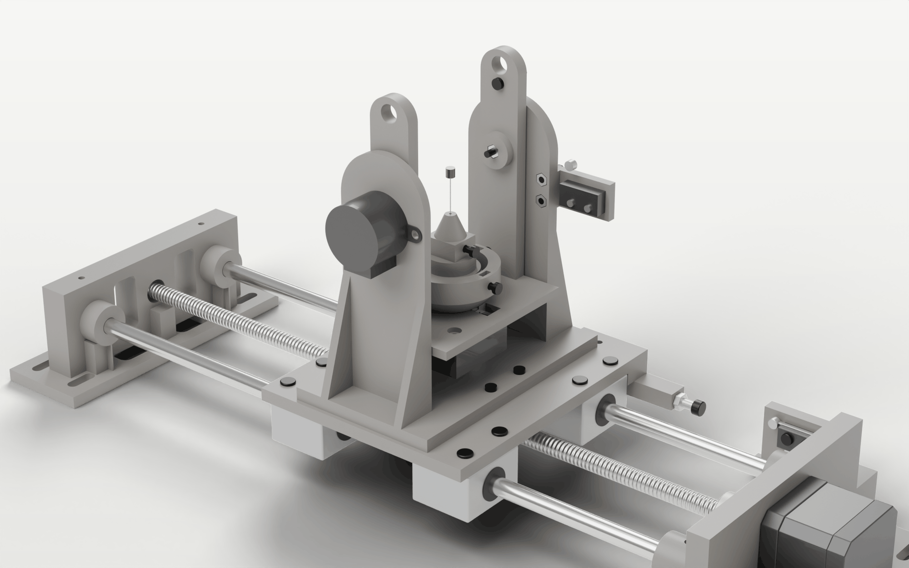
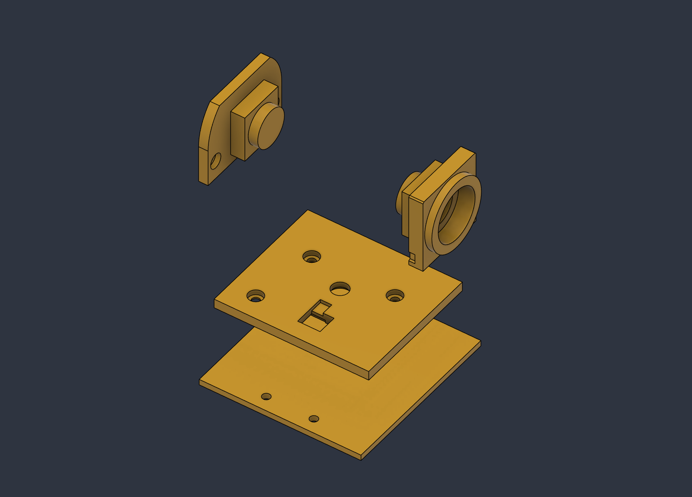

# Scan module: hardware

The bolt-on 3D scan module for the MacroRail: a printed fork on the rail's carriage with a
motorised tilt cradle and yaw head, and a hand-adjusted centring plate that holds the specimen
pin. What it does and how it is used: [`docs/3d-scanning.md`](../../docs/3d-scanning.md). The
measurements it was designed around: [`MEASUREMENTS.md`](MEASUREMENTS.md).

Assembly, wiring and use, step by step with pictures: the
[scan module guide](../../docs/guides/MacroRail-scan-module-guide.pdf).

| Folder | Holds |
|---|---|
| `exports/final/` | The printed parts (STL) |
| `exports/test-pieces/` | Fit-test slices of the large parts |
| `fusion/` | Scripts that build the Fusion 360 model, check it and export the STLs |
| `diagrams/` | Measurement diagrams (objective, carriage holes, 28BYJ-48) |

## Printing

Printed in PLA on a Prusa i3 MK3. The STLs are in model coordinates, so use
*Place on face* in the slicer.

| Part | Qty | Face on the bed | Notes |
|---|---|---|---|
| Fork | 1 | Base underside | The bearing seat and motor seat print as horizontal holes; check them with the test pieces first. |
| Cradle | 1 | Floor underside | The arms print upright (about 110 mm). |
| Yaw Head | 1 | Bell underside (flat) | Snap off the thin fin under the spring housing after printing. |
| Specimen Holder | 1 | Plate underside | Centring plate, clamp column and nose in one part, nose up. |
| Tilt Axle | 1 | Flange | Shank vertical, so it comes out round. |
| Axle Spacer | 1 | Flat | |
| Carriage Washer | 4 | Flat | |
| Height Gauge | 1 | Underside | Steps at 17, 18, 19, 20 and 21 mm above the nose tip. |
| Endstop Bracket | 1 | Back (flat side) | Pad side up. Ø1.5 pilot holes for the switch's wood screws. |

Fits used throughout: M3 clearance 3.4; M3 nut pocket 5.7 across flats × 2.6 deep; no threads
in plastic; counterbores rather than countersinks.

### Test pieces

Print these before the large parts. The six `tp-*` files are slices of the real bodies; the
small parts are printed whole and serve as their own test.

| Test piece | Check |
|---|---|
| `tp-bearing-seat` | The 608 presses in by hand or in a vice and doesn't fall out; the lip stops it. |
| `tp-motor-seat` | The tilt motor's boss drops into the recess, both ear bolts line up, the counterbored heads sit flush. |
| `tp-base-holes` | Laid on the carriage, the four bolts line up and it sits flat over the screw heads (bottom 2.5 mm of the base only). |
| `tp-tilt-d-bore` | Goes onto the motor shaft (on `tp-motor-seat`) firmly by hand, covers the flats, no play. |
| `tp-axle-socket` | The axle's spigot fits; the nut presses into its pocket. |
| `tp-cradle-floor` | Yaw motor boss, ear bolts, KY-024 bolt and board seat, sensor pocket and lead slot. |
| `yaw-head` | Fits the yaw shaft; set-screw nut, centring nuts, magnet and spring go in; the fin snaps off cleanly. |
| `specimen-holder` | Slides freely in the ring between the screw tips and the spring; the pin slides through the nose; the clamp nut can't turn. |
| `endstop-bracket` | Bolts to the +Y upright; the switch's holes line up with the pilot holes and the wood screws bite. |
| `tilt-axle`, `axle-spacer` | The axle slips through the 608; the spacer slides over it. |

If a fit is wrong on your printer, change its parameter and re-export: `fit_press` (608 seat),
`fit_D` (yaw D-bore), `fit_Dt` (tilt D-bore), `fit_slide`, `boss_clr`, `m3_pocketAF`,
`clampNut_H`, `magPocketD`, `pinHoleD`, `ws_pilotD`.

The current values came from two rounds of test prints:

| Fit | Value | Note |
|---|---|---|
| `fit_press` | 0.35 | 0.25 was slightly tight on the 608. |
| `fit_D` | 0.1 | Yaw D-bore, printed vertically; at 0.2 it held only with the set screw tight. |
| `fit_Dt` | 0.05 | Tilt D-bore, printed on its side, so it needs its own fit. |
| Magnet pocket | +0.4 | +0.2 was too small. |
| `pinHoleD` | 1.2 | 1.0 was tight. |
| `upM_T` | 4 | The motor-side upright is 4 mm (not 6) so the short 28BYJ-48 shaft engages the cradle hub by 6.2 mm. |

## Hardware

| Item | Qty | Where |
|---|---|---|
| 28BYJ-48 + ULN2003 board | 2 | Tilt (outside the −Y upright), yaw (under the cradle floor) |
| 608 bearing | 1 | +Y upright |
| KY-024 linear hall board | 1 | Under the cradle floor; bend its sensor flat into the floor pocket, legs into the slot |
| Magnet Ø5.7 × 1.8 | 1 | Hub underside (yaw home) |
| Pen spring, OD 4.6, free length 19 | 1 | Spring housing; pushes straight on the holder's rim |
| Roller microswitch + 2 wood screws Ø1.9 | 1 | On the endstop bracket, pivot end towards the camera (+X), pins down; glued as well |
| M3 × 17.5 + nut | 5 | Base to carriage (4, with the printed washers), tilt home flag (1) |
| M3 × 11.8 + nut | 11 | Tilt motor (2), yaw motor (2), KY-024 (1), centring screws (2), pin clamp (1), hub set screw (1), endstop bracket (2) |
| M3 × 27.7 + nut | 1 | Tilt axle |

All screws are button heads turned with a 2 mm hex key. The app turns each centring screw
round to face you.

Under the carriage the stack is base 6 + carriage 6 + washer 1.5 + nut 2.2 = 15.7 mm, so a
17.5 mm bolt shows 1.8 mm past a full nut. The nuts (X ±30, Y ±10) clear the lead-screw nut
carrier, the bearing blocks and the lead screw. The KY-024 bolt sticks out about 6 mm below
the board's nut, near the potentiometer.

The tilt switch should click with the flag bolt at about +97°, past the +90° working limit.
The app's tilt calibration measures the real angle, so the bracket only needs moving if it
lands far from that.

## Verification (CAD)

- **Lens clearance:** every moving body against the objective plus 2 mm, over tilt × yaw
  every 45°. The back side is free to +90° (checked to +100°) with at least 10.8 mm to the
  zone. On the belly side −33° keeps 1.1 mm to the zone (3.1 mm to the glass); the pin, nose
  and spring housing reach the zone at about −35°. Hence tilt limits of −33° to +90°.
- **Tilt home:** the flag bolt meets the roller at +90° (the switch clicks at +97°) and clears
  the bracket and switch body by 2.3 mm even at +100°; it clears the fork by 4.5 mm over
  −35° to +100°.
- **Moving against fixed parts:** the cradle never comes closer to the fork than the 1 mm
  design gap at any tilt, and the yaw head clears the cradle all the way round (1 mm, hub to
  floor).
- **Interference at rest:** only the intended overlaps remain: bolts through their nuts, and
  the switch's wood screws into the bracket.
- **Hall sensor:** 0.8 mm under the hub magnet at the home angle.
- **Parameter stress test:** eleven key parameters changed at once (arm gap, plate size, pin
  length, axis height, hole spacing, motor tab spacing, bearing, magnets, board length); the
  model rebuilt healthy.

## The CAD model

The Fusion 360 model is built entirely by the stage scripts in [`fusion/`](fusion/), run in
order (each as a script that calls `runpy.run_path(<stage file>)['run'](context)`). A rebuild
from an empty timeline gives 57 bodies, every feature healthy and every sketch fully
constrained.

| Stage | Builds |
|---|---|
| `stage_01_params.py` | All user parameters (MEAS = measured, REF = reference only) |
| `stage_02_reference.py` | Carriage, objective and lens keep-out, insect, pin, 608, both motors, KY-024, hall sensor |
| `stage_03_fork.py` | Fork: base, uprights, ribs, 608 seat, tilt motor seat, endstop bracket holes |
| `stage_04a_cradle.py`, `stage_04b_cradle_floor.py` | Cradle: arms, tilt hubs, counterweight holes, flag bolt hole, floor seats |
| `stage_05a_head.py` … `stage_05d_head_hardware.py` | Yaw head (bell hub, ring), spring housing, snap-off fin, the centring plate, head hardware |
| `stage_06_puck.py` | Top of the specimen holder (neck, clamp column, nose) and the pin clamp |
| `stage_07a_axle_washers.py`, `stage_07b_gauge.py` | Tilt axle, spacer, carriage washers and bolts, height gauge |
| `stage_07c_endstop.py` | Endstop bracket, reference switch, roller, screws, bolts |
| `stage_08_present_pose.py` | Appearances, selection sets, the two pose moves |
| `stage_09_test_pieces.py` | Test pieces (slices of the real bodies) |
| `stage_10_explode.py` | `explode` parameter (0/1) and one Move per part group, for the guide pictures |
| `verify_*.py` | Clearance sweep, interference, sections |
| `export_stl.py` | Print files (`exports/`); product renders come from `hardware/render/` |

- **Parameters drive everything** (190+). Change a parameter, not a feature; dimensions are
  expressions such as `d_floorTop = d_hubBot + gap`.
- **Coordinates:** origin at the insect, where the yaw and tilt axes cross. X runs along the
  lens axis towards the camera, Y along the tilt axis, Z up. `d_*` parameters are depths below
  the insect.
- **Bodies, not components.** Printed parts have plain names (`Fork`, `Cradle`, `Yaw Head`,
  ...), reference geometry `REF ...`, test pieces `TP ...`. Features and sketches carry part
  prefixes (`FK`, `CR`, `HD`, `PT`, `PK`, `AX`, `AS`, `WS`, `GG`, `ES`, `TP`). Selection sets:
  `1 Printed Parts`, `2 Hardware`, `3 Reference`, `4 Lens Keep-out`, `5 Test Pieces`.
- **Poses:** `pose_tilt` (+ turns the back of the insect towards the camera) and `pose_yaw`
  drive two Move features near the end of the timeline, and `explode` the moves after them.
  Keep all three at 0 for export (`export_stl.py` does). Add new features before `POSE Yaw`.
- **Sections** (saved, hidden): `SEC Stack XZ`, `SEC Tilt Axis YZ`, `SEC Carriage Bolts YZ`,
  `SEC Yaw Motor Bolts XZ`.
- Run one stage per call and save a version after each; a long-running script can
  crash Fusion.

The guide ([`docs/guides/`](../../docs/guides/README.md)) is built by `docs/guides/build.py`;
its pictures are rendered by [`hardware/render/`](../render/README.md).
